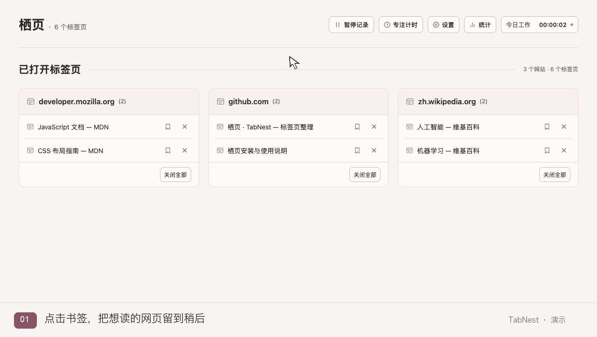
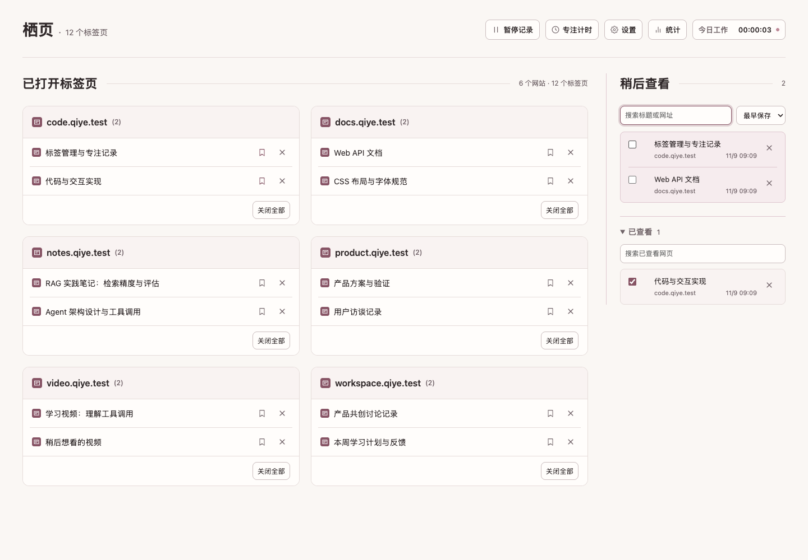
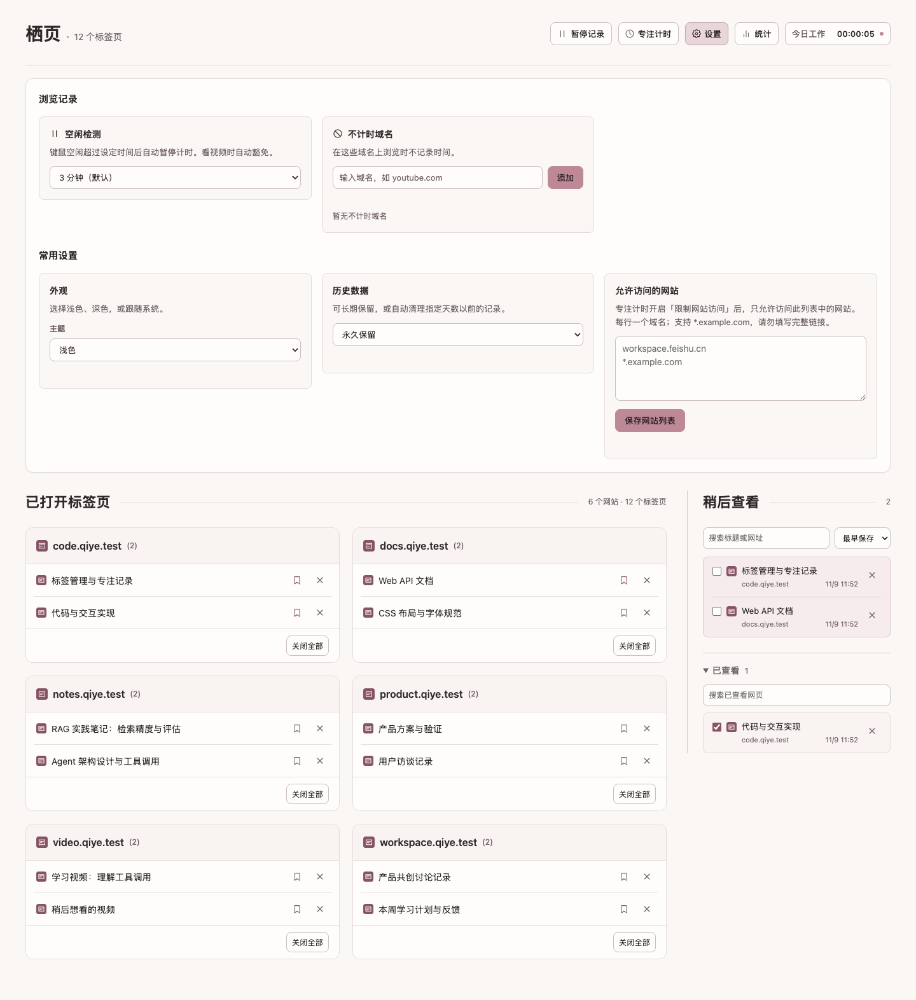

<p align="center">
  
</p>

<h1 align="center">栖页 · TabNest</h1>

<p align="center">给打开的网页一个去处，也给注意力留一点空间。</p>

栖页是一个 Chrome 新标签页扩展，帮你整理散落的标签页，把想读的网页保存下来，并在阅读后标记为「已查看」。暖白与淡粉色界面，搭配「栖息小鸟」图标。

**Chrome Manifest V3 · 本地存储 · 无需注册 · MIT 许可**

[下载插件](https://github.com/Maxine0917/Qiye/releases/latest/download/TabNest-Chrome.zip) · [让 Agent 帮你安装](#让-agent-帮你安装) · [安装步骤](#从插件包安装) · [版本说明](https://github.com/Maxine0917/Qiye/releases/latest)



*动图基于实际扩展的操作截图制作，添加了鼠标与步骤提示；使用独立浏览器中的演示数据。*

<details>
<summary>查看静态工作台截图</summary>



</details>

## 为什么做栖页

随着打开的网页越来越多，
1. 标签页分散：对自己打开的网页没有清晰的概括认知。
2. 注意力失焦：在海量的标签页中找不到目标网页，只能重新打开。
3. 精力无法统计：复盘一天后不知道自己在哪些网页上花了时间

栖页把「已打开标签页」「稍后再看」「已经看过」放在同一张工作台上，让网页整理和阅读进度连起来。

## 核心功能

| 功能 | 你可以做什么 |
| --- | --- |
| 已打开标签页 | 按网站自动整理，跨窗口跳转，关闭单页、整组或重复页面 |
| 稍后查看 | 点击书签保存网页，按标题或网址搜索，调整排序 |
| 已查看 | 勾选后移入已查看区；取消勾选恢复，支持折叠和独立搜索 |
| 浏览统计 | 查看今日用时、网站与标签页用时、历史统计及热力图 |
| 专注控制 | 使用专注倒计时、允许访问网站、暂停记录和空闲检测 |
| 数据与外观 | 浏览历史导出为 JSON / CSV，设置保留期限，切换浅色、深色或跟随系统 |

保存状态跨刷新保留，也会在多个新标签页之间同步。打开保存的链接不会删除记录或自动标记已查看；没有待查看和已查看记录时，右侧分区隐藏。

## 快速安装

### 让 Agent 帮你安装

复制下面这句话，发给能联网并操作你电脑文件的 Agent：

```text
请帮我把 https://github.com/Maxine0917/Qiye 的栖页插件安装到本机 Chrome：先阅读仓库 README 和 docs/INSTALL.md，下载该仓库默认分支的源码 ZIP，解压到长期保留的目录并保留根目录 LICENSE（若已有安装，先确认原安装路径再处理），核对 extension/manifest.json，给出 extension 文件夹的绝对路径，再引导我在 chrome://extensions 开启开发者模式、点击“加载已解压的扩展程序”并选择该文件夹，最后新建标签页确认栖页正常显示。
```

Agent 会帮你准备安装文件；Chrome 中的加载操作仍需你确认。无需安装 Node.js、Python 或运行打包脚本。安装目录请保留，后续更新沿用同一路径。

### 从源码安装

1. 在本仓库点击 **Code → Download ZIP**，下载后解压。
2. 在 Chrome 地址栏输入 `chrome://extensions`，打开右上角的**开发者模式**。
3. 点击**加载已解压的扩展程序**，选择解压后的 **`extension` 文件夹**。
4. 新建一个标签页，进入栖页。

请选择包含 `manifest.json` 的目录。扩展运行不需要 Node.js、Python 或服务器。

### 从插件包安装

1. [下载最新版 TabNest-Chrome.zip](https://github.com/Maxine0917/Qiye/releases/latest/download/TabNest-Chrome.zip)，解压到长期保留的目录。
2. 在 Chrome 地址栏输入 `chrome://extensions`，打开右上角的**开发者模式**。
3. 点击**加载已解压的扩展程序**，选择解压后含 `manifest.json` 的目录。
4. 新建一个标签页，进入栖页。

Chrome 的「加载已解压的扩展程序」不能直接选择 ZIP 文件。通过本地脚本或 Actions 获得的 `栖页-插件.zip` 使用相同的安装方式。下载源码请前往 [Releases](https://github.com/Maxine0917/Qiye/releases/latest)，选择 `TabNest-Source.zip`。

### 更新已有安装

更新同一加载目录中的文件，再在 `chrome://extensions` 点击扩展卡片上的 **↻ 重新加载**，最后新建标签页。只刷新网页不会更新 Chrome 记录的扩展名称和图标。

加载路径影响本地扩展身份，换目录后数据不会自动迁移。更多情况见[安装与更新](docs/INSTALL.md)。

## 一个简单的使用流程

1. 新建标签页，查看按网站排列的已打开网页。
2. 对想留着读的网页点击书签，放入「稍后查看」。
3. 阅读完成后勾选条目，移入「已查看」；需要重读时取消勾选。
4. 用顶部的专注计时、暂停记录和统计入口管理当前浏览状态。

<details>
<summary>查看设置界面</summary>



</details>

## 问题反馈与功能建议

遇到异常，请[提交问题反馈](https://github.com/Maxine0917/Qiye/issues/new?title=问题反馈：)，说明 Chrome 版本、插件版本、复现步骤，以及预期和实际表现；截图请遮挡个人信息。

如果有希望改进的使用场景，欢迎[提出功能建议](https://github.com/Maxine0917/Qiye/issues/new?title=功能建议：)，描述你遇到的困扰、目前的处理方式，以及希望达到的效果。

## 隐私与数据

浏览记录、保存网页和设置存储在本机的 `chrome.storage.local` 中。扩展没有账号系统，不向分析或遥测服务上传这些记录。

网页图标可能从原网站加载，点击链接也会访问对应网站；这些请求受网站自身的隐私政策约束。完整权限用途见[隐私说明](PRIVACY.md)。

目前支持浏览历史导出，尚不提供保存列表和设置的完整导入迁移工具。卸载前请保留需要的数据。

## 开发与验证

项目使用原生 HTML、CSS 和 JavaScript ES Modules，无构建步骤即可加载。以下命令在项目根目录运行；测试需要 Node.js 22 或更高版本，打包需要 Python 3。

```bash
# 回归测试
node extension/tests/nodeRunner.mjs

# 后台启动检查
node extension/tests/swSmoke.mjs

# 生成插件包与完整源码包
python3 scripts/package.py
```

打包后得到：

```text
dist/
├── 栖页-插件.zip   # 运行资源与许可证，可解压安装
└── qiye-源码.zip   # 源码、测试、文档与 GitHub Actions
```

浏览器验收需要另行安装 Playwright，并安装可用的 Chrome：

```bash
npm install --no-save --package-lock=false playwright
node extension/tests/browser-ui.mjs
```

验收使用独立临时浏览器配置，覆盖保存、已查看、刷新保留、多页面同步、主题和窄屏布局。若 Playwright 位于其他位置，可用 `PLAYWRIGHT_MODULE` 指定模块入口；截图默认保存到系统临时目录，可用 `QIYE_SCREENSHOT_DIR` 调整。

GitHub Actions 会执行回归测试、后台启动检查和打包，通过后可在该次运行的 Artifacts 中下载 `qiye-packages`。

## 项目结构

```text
qiye/
├── extension/         # Chrome 加载此目录
│   ├── background/    # 存储、计时、专注与同步
│   ├── shared/        # 常量、类型与消息协议
│   ├── ui/            # 界面与交互
│   ├── icons/         # 栖息小鸟 SVG 与 PNG 图标
│   └── tests/         # 回归测试与浏览器验收
├── docs/              # 安装、架构、设计决策与展示素材
├── scripts/           # 打包工具
├── .github/workflows/ # 自动检查
├── README.md
├── PRIVACY.md
└── LICENSE
```

[架构说明](docs/ARCHITECTURE.md) · [开发决策](docs/DECISIONS.md) · [更新记录](CHANGELOG.md) · [发布指南](docs/PUBLISH.md)

## 许可与致谢

项目在已有 MIT 许可代码基础上继续开发，感谢 Zara Zhang 的原有贡献。版权主体、年份、MIT 授权及免责条款保留于 [LICENSE](LICENSE)。
