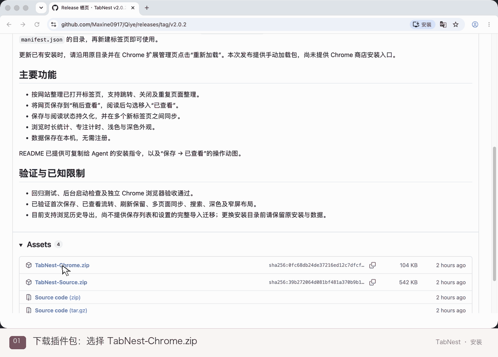

# 安装与更新栖页

## 支持的浏览器

栖页基于 Chromium Manifest V3，同一份运行目录可以加载到 Chrome 和 Microsoft Edge，无需分别打包。两个浏览器各自维护独立的数据。

## 从插件包安装（推荐）

1. [下载最新版 TabNest-Chrome.zip](https://github.com/Maxine0917/Qiye/releases/latest/download/TabNest-Chrome.zip)，解压到长期保留的目录。
2. 在 Chrome 地址栏输入 `chrome://extensions`，打开右上角的**开发者模式**。
3. 点击**加载未打包的扩展程序**，选择解压后直接包含 `manifest.json` 的目录。
4. 点击浏览器的「＋」，确认栖页正常显示。如果 Chrome 提示新标签页已被扩展更改，选择**保持现状**。

部分 Chrome 版本将第 3 步按钮称为「加载已解压的扩展程序」，作用相同。



动图使用 macOS、真实 v2.0.2 插件包和独立 Chrome 配置录制，添加了鼠标与步骤提示并做了剪辑。其他系统的解压和文件选择界面可能不同；Chrome 中的加载方式相同。

插件包解压后的加载目录如下，文件夹名称可自行选择：

```text
TabNest-Chrome/          ← Chrome 加载这个目录
├── manifest.json
├── index.html
├── background/
├── ui/
├── icons/
└── LICENSE
```

Chrome 不能直接加载 ZIP，也不能选择 `manifest.json` 文件本身。插件包无需再选择 `extension/` 子目录。安装后请保留整个加载目录；使用栖页不需要 Node.js、Python 或服务器。

本地打包或 GitHub Actions 中的 `栖页-插件.zip` 与 Release 的 `TabNest-Chrome.zip` 采用相同的目录结构和安装步骤。

## 在 Edge 中安装

1. 下载并解压同一份 `TabNest-Chrome.zip`，保留包内 `LICENSE`。
2. 在 Edge 地址栏输入 `edge://extensions`，开启「开发人员模式」。
3. 点击「加载解压缩的扩展」，选择解压后直接包含 `manifest.json` 的目录。
4. 点击浏览器的「＋」，确认栖页正常显示。

从源码安装时，选择源码中的 `extension/`。更新时沿用原目录，再到 `edge://extensions` 点击扩展卡片上的「重新加载」。本地加载无需通过扩展商店。

## 从源码安装（进阶）

1. 下载 [TabNest-Source.zip](https://github.com/Maxine0917/Qiye/releases/latest/download/TabNest-Source.zip)，或使用仓库的 **Code → Download ZIP**，解压到长期保留的目录。
2. 在 `chrome://extensions` 开启**开发者模式**，点击**加载未打包的扩展程序**（部分版本叫「加载已解压的扩展程序」）。
3. 选择源码中的 `extension/` 文件夹，再点击浏览器的「＋」验证。

`TabNest-Source.zip` 解压后为 `qiye/extension/`；Code 下载的 ZIP 外层目录随分支变化，选择其中的 `extension/` 即可：

```text
qiye/
├── LICENSE             ← 与源码一起保留
├── README.md
└── extension/          ← Chrome 加载这个目录
    ├── manifest.json
    ├── index.html
    └── ...
```

## 更新已有安装

1. 在 `chrome://extensions` 的扩展详情中核对原加载目录。
2. 下载新版 `TabNest-Chrome.zip`，先解压检查，再将运行文件更新到原加载目录。如果原来从源码加载，更新的是源码中的 `extension/`，不要改为加载外层目录。
3. 在扩展卡片上点击 **↻ 重新加载**，再新建标签页确认。

同一路径更新通常保留本地数据。换目录或卸载后重新安装可能改变扩展身份，不会自动迁移保存网页与设置；更新前请保留原安装，数据能力见下方说明。

## 常见安装问题

- **提示找不到清单文件：**选择的目录必须直接包含 `manifest.json`；检查是否多选了外层文件夹。
- **点击「＋」仍是其他页面：**确认栖页已启用，并检查是否有其他扩展接管新标签页；无需立即卸载栖页。
- **文件夹被移动或删除：**Chrome 会继续引用原路径，可能无法加载。尽量将文件放在长期保留的位置。
- **更新后名称或图标没变：**需要在扩展管理页重新加载，仅刷新网页不够。

## 已加载扩展但名称仍旧

Chrome 新标签页最底部、与「自定义 Chrome」同一行的名称由浏览器生成，使用已加载扩展的名称；Edge 中对应信息同样来自扩展清单。页面标题已更新、底部仍显示旧名时，普通刷新网页不会让浏览器重新读取扩展清单。

1. 打开扩展管理页：Chrome 为 `chrome://extensions`，Edge 为 `edge://extensions`。
2. 开启「开发者模式」/「开发人员模式」。
3. 找到接管新标签页的扩展，在「详情」中核对其加载目录。
4. 返回扩展列表，点击该扩展卡片上的圆形箭头「重新加载」。
5. 再新建一个标签页，检查底部是否显示「栖页」。

当前项目的 `extension/manifest.json` 中，`name`、`short_name` 与 `action.default_title` 均为「栖页」。重新加载只会刷新原安装目录中的文件，不会切换到另一个目录；更新时应沿用当前加载目录。

如果仍显示其他名称，检查是否有另一个扩展同时接管新标签页；先禁用多余扩展再验证，不必立即卸载。

标签列表展示所打开网页的真实标题。第三方网页标题可能包含其他产品名称，这些文字来自网页本身；关闭该网页后，对应的已打开标签条目会消失。

## 数据保留

同一路径更新并重新加载通常沿用原本地数据。换目录加载可能生成不同的扩展身份，保存的网页和设置不会自动迁移。Chrome 与 Edge 各自维护独立的扩展存储，切换浏览器不会自动同步数据。

本版本支持浏览历史导出，不提供完整保存列表和设置的导入迁移工具。需要保留数据时，先保留已有安装和目录，不要直接卸载。
